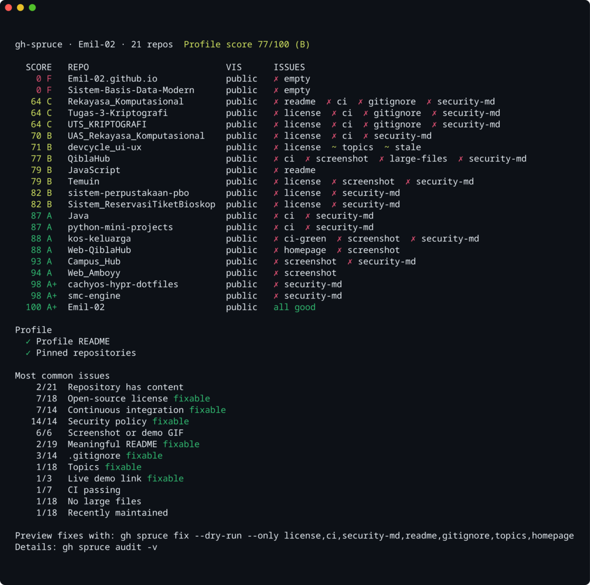

# gh-spruce 🌲

**Lighthouse untuk profil GitHub kamu.** Audit semua repository dalam hitungan detik, dapatkan skor kesehatan 0–100, perbaiki hal-hal membosankan dengan satu perintah, lalu pamerkan hasilnya di profil.

🇬🇧 [Read in English](README.md)

<p align="center">
  
</p>



Banyak dari kita punya puluhan repo tanpa lisensi, tanpa CI, dan tanpa deskripsi. Ada juga README yang masih bawaan *create-next-app*, file `.env` yang terlanjur ter-push, atau repo kosong "nanti saja diisi". Perekrut dan pengunjung akan memperhatikan hal-hal ini. Merapikannya satu per satu bisa memakan satu akhir pekan.

`gh spruce` merapikannya dengan satu perintah:

- **Audit** semua repo milik user atau organisasi, publik maupun privat, secara paralel.
- **Skor** 0–100 untuk tiap repo dan untuk profil secara keseluruhan, dengan model penilaian yang mudah dipahami.
- **Perbaikan otomatis**: satu pull request per repo berisi LICENSE, workflow CI sesuai stack, kerangka README, `.gitignore`, dan `SECURITY.md`. Deskripsi, topics, dan link demo juga diisi.
- **Kartu SVG** untuk README profil yang diperbarui otomatis lewat GitHub Action.

## Instalasi

Butuh [GitHub CLI](https://cli.github.com/).

```bash
gh extension install Emil-02/gh-spruce
```

## Mulai cepat

```bash
gh spruce audit              # nilai semua repo kamu
gh spruce audit -v           # sertakan alasan dan saran untuk tiap masalah
gh spruce fix --dry-run      # lihat dulu apa yang akan diubah
gh spruce fix                # buat pull request (minta konfirmasi dulu)
gh spruce card               # tulis spruce-card.svg
gh spruce tui                # mode interaktif
```

## Aman dipakai

- Tidak ada yang berubah sebelum kamu konfirmasi. `--dry-run` hanya menampilkan pratinjau, dan `--show` mencetak isi tiap file.
- Perubahan file dikirim sebagai **pull request** dari branch `spruce/fixes`. Pakai `--direct` kalau ingin commit langsung ke branch utama.
- Fork, repo yang diarsipkan, dan repo yang tidak bisa kamu push dilewati.
- Pemeriksaan secret hanya melihat **nama file**. Isinya tidak pernah diunduh atau ditampilkan.
- Untuk menambahkan workflow, token gh butuh scope `workflow`: `gh auth refresh -s workflow`.

## Kartu di README profil

Tambahkan workflow berikut ke repo `<username>/<username>`, lalu tulis `` di README-nya:

```yaml
name: Repo health card
on:
  schedule:
    - cron: "0 3 * * 1"
  workflow_dispatch:
permissions:
  contents: write
jobs:
  card:
    runs-on: ubuntu-latest
    steps:
      - uses: actions/checkout@v7
      - uses: Emil-02/gh-spruce@v0.1.0
```

Daftar lengkap pemeriksaan, cara penilaian, dan konfigurasi ada di [README bahasa Inggris](README.md).

## Kontribusi

Pemeriksaan baru, template CI, dan tema kartu sangat diterima. Panduannya ada di [CONTRIBUTING.md](CONTRIBUTING.md).

## Lisensi

[MIT](LICENSE) © 2026 Emil Rahmat
