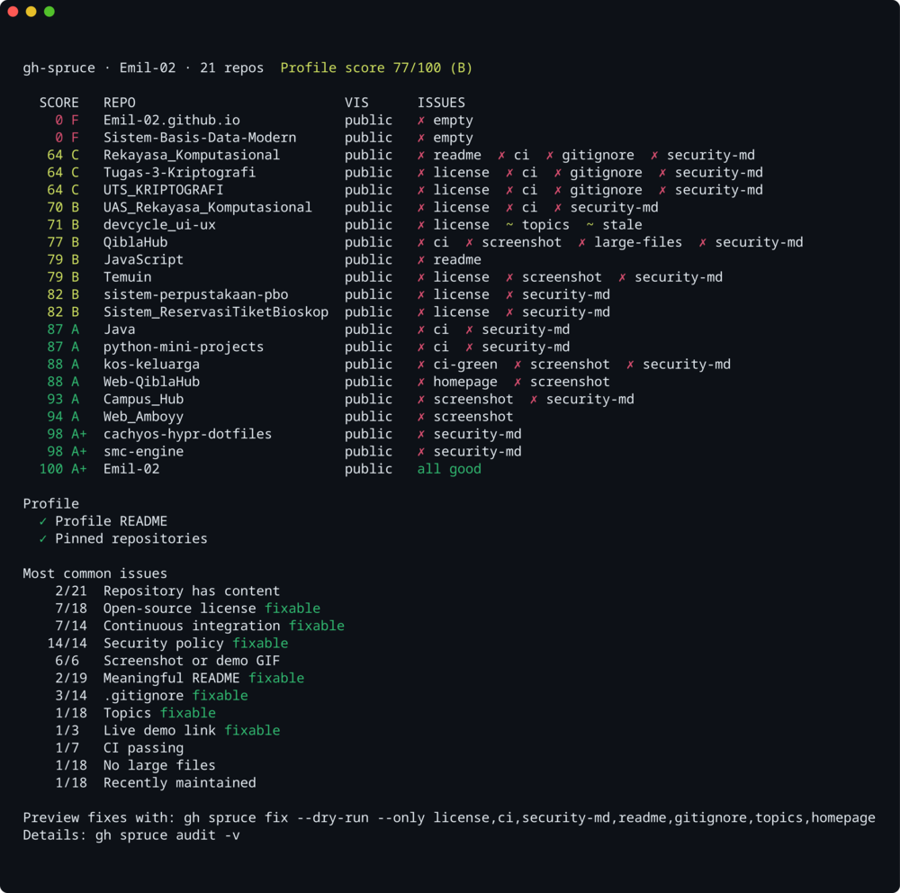

# gh-spruce 🌲

**Lighthouse for your GitHub profile.** Audit every repository you own in seconds, get a 0–100 health score, fix the boring stuff with one command, and show off the result on your profile.

[](https://github.com/Emil-02/gh-spruce/actions/workflows/ci.yml)
[](https://github.com/Emil-02/gh-spruce/releases)
[](LICENSE)
[](https://cli.github.com/manual/gh_extension)

🇮🇩 [Baca dalam Bahasa Indonesia](README.id.md)

<p align="center">
  
</p>



Most of us have dozens of repositories with no license, no CI, no description, a README that still says *"This is a Next.js project bootstrapped with create-next-app"*, a forgotten `.env`, or a few empty "I'll do it later" repos. Recruiters and visitors notice. Fixing it by hand takes a whole weekend.

`gh spruce` does it in one command:

- **Audit** every repository of a user or organization – public and private – in parallel.
- **Score** each repository and your whole profile from 0 to 100 with a clear, explainable model.
- **Fix** what can be fixed automatically: one pull request per repository with a LICENSE, a CI workflow generated for the detected stack, a README skeleton, `.gitignore` and `SECURITY.md`; plus description, topics and live-demo links.
- **Share** an SVG health card for your profile README that refreshes itself with a GitHub Action.

## Install

Requires the [GitHub CLI](https://cli.github.com/).

```bash
gh extension install Emil-02/gh-spruce
```

## Quick start

```bash
gh spruce audit              # score all of your repositories
gh spruce audit -v           # ...with the reason and a hint for every issue
gh spruce fix --dry-run      # preview the fixes
gh spruce fix                # open pull requests (asks for confirmation first)
gh spruce card               # write spruce-card.svg
gh spruce tui                # browse interactively and pick what to fix
```

Audit anyone's public profile or an organization:

```bash
gh spruce audit torvalds
gh spruce audit my-org --public --md -o HEALTH.md
```

## Commands

| Command | What it does |
|---|---|
| `gh spruce audit [owner \| owner/repo]` | Table (default), `--json` or `--md` report. `--fail-under 80` exits non-zero, handy in CI. |
| `gh spruce fix [owner \| owner/repo]` | Applies fixes. `--dry-run`, `--show` (print file contents), `--only license,ci`, `--license apache-2.0`, `--direct`, `--yes`. |
| `gh spruce card [owner]` | Renders the SVG card. `--theme dark\|light\|transparent\|dracula\|nord`, `-o file.svg` or `-o -`. |
| `gh spruce tui [owner]` | Interactive browser: `space` select, `a` select all fixable, `f` fix, `o` open in browser. |
| `gh spruce checks` | Lists every check with its weight, scope and whether it can be fixed. |

Common flags: `-R/--repo`, `--public`, `--private`, `--include-forks`, `--include-archived`, `--config`, `--concurrency`.

## What is checked

| Check | Weight | Auto-fix |
|---|---:|---|
| Repository has content (empty repos score 0) | gate | archive, opt-in with `--only empty` |
| Meaningful README (exists, not framework boilerplate, not tiny) | 15 | README skeleton |
| Open-source license *(public)* | 15 | LICENSE from GitHub's license API |
| Repository description | 10 | first sentence of the README |
| At least 3 topics *(public)* | 10 | inferred from stack, language and README |
| Live demo link *(public, when a Vercel/Netlify/Pages/… URL is found)* | 5 | sets the homepage |
| Continuous integration | 10 | workflow for Next.js/Vite/Node (npm, pnpm, yarn, bun), Flutter, Dart, Python, Go, Maven, Gradle, plain Java, Rust |
| CI passing on the default branch | 5 | – |
| Screenshot or GIF in the README *(public apps)* | 5 | – |
| `.gitignore` | 5 | from GitHub's gitignore templates |
| No committed `node_modules`, `.next`, `__pycache__`, `.dart_tool`, … | 5 | – (shows the `git rm --cached` command) |
| No files over 10 MB, repository not bloated | 5 | – |
| No committed secrets (`.env`, private keys, keystores, service accounts) | 10, **critical** | – (never automatic) |
| Pushed in the last year | 3 | – |
| `SECURITY.md` *(public)* | 2 | GitHub private vulnerability reporting policy |

**Scoring:** a repository earns the weight of every passing check, half for warnings, divided by the weight of the checks that apply to it. Empty repositories score 0 and a critical failure caps the score at 40. The **profile score** is 90 % the average of your public repositories (what visitors see) and 10 % profile checks: a profile README and pinned repositories that are actually public.

## Fixing safely

- Nothing changes until you confirm. `--dry-run` previews and `--show` prints every file.
- File changes go into **one pull request per repository** from the branch `spruce/fixes`. Use `--direct` to commit to the default branch instead.
- Description, topics and homepage are repository settings, so they are updated directly.
- Forks, archived repositories and repositories you cannot push to are skipped.
- Everything uses the GitHub API. Nothing is cloned.
- The secrets check looks at **file names only**. It never downloads or prints file contents. To scan contents and history, use [gitleaks](https://github.com/gitleaks/gitleaks).
- Adding workflow files needs the `workflow` scope: `gh auth refresh -s workflow`.

## Health card for your profile README

Add `.github/workflows/spruce.yml` to your `<username>/<username>` repository:

```yaml
name: Repo health card
on:
  schedule:
    - cron: "0 3 * * 1"   # every Monday
  workflow_dispatch:

permissions:
  contents: write

jobs:
  card:
    runs-on: ubuntu-latest
    steps:
      - uses: actions/checkout@v7
      - uses: Emil-02/gh-spruce@v0.1.0
        with:
          theme: dark          # light, transparent, dracula, nord
          output: spruce-card.svg
```

Then add it to your README:

```markdown

```

The card only counts public repositories, so it is safe to publish. The action also outputs `score` and `grade`.

## Configuration

Optional. Put a `.spruce.yml` in the current directory or in `~/.config/gh-spruce/config.yml`. All fields are optional, see [.spruce.example.yml](.spruce.example.yml).

```yaml
ignore: ["SEM_*", playground]   # skip repositories (glob patterns)
disable: [security-md]          # turn checks off
weights: { ci: 15 }             # change weights
license: apache-2.0             # license used by `fix`
holder: Jane Doe                # copyright holder
```

## Use it in CI for an organization

```yaml
- run: gh extension install Emil-02/gh-spruce
  env: { GH_TOKEN: "${{ github.token }}" }
- run: gh spruce audit my-org --public --md -o health.md --fail-under 75
  env: { GH_TOKEN: "${{ github.token }}" }
```

## How is it different?

| | gh-spruce | Per-repo checkers | Org policy tools |
|---|---|---|---|
| Scans a whole account in one command | ✅ | ❌ | ✅ |
| Explainable score per repository and profile | ✅ | partly | ❌ |
| Bulk fixes as reviewable pull requests | ✅ | ❌ | partly |
| CI generated for the detected stack | ✅ | ❌ | ❌ |
| Shareable profile card and Action | ✅ | ❌ | ❌ |
| No server, no AI key, no clone | ✅ | varies | varies |

## Contributing

New checks, CI templates and card themes are very welcome. Look for [good first issues](https://github.com/Emil-02/gh-spruce/labels/good%20first%20issue) and read [CONTRIBUTING.md](CONTRIBUTING.md).

```bash
git clone https://github.com/Emil-02/gh-spruce && cd gh-spruce
go test ./...
make install   # use your local build as `gh spruce`
```

## License

[MIT](LICENSE) © 2026 Emil Rahmat
